<div align="center">

<!-- Animated Header -->


<br/>

<!-- Cyber Header -->


</div>

<!-- About Me -->
## 🧠 `whoami`

```bash
chris@cachyos ~> neofetch --about-me
```

🎓 **IT Student** @ [Soegijapranata Catholic University](https://www.unika.ac.id/)

🛡️ Cybersecurity and IT infrastructure enthusiast

⚙️ Systems engineering — Linux, networking, databases, and service reliability

🐧 Daily driving **CachyOS** with **KDE** and **Hyprland**

🔧 When I'm not studying networking, tuning services, or poking at vulnerable machines

📍 Indonesia

---

<!-- Focus -->
## 🎯 What I Do

<div align="center">

| 🛡️ Security | ⚙️ Systems Engineering |
| :---: | :---: |
| Network analysis & packet inspection | Linux administration & hardening |
| Vulnerability assessment & pentesting | Service deployment, monitoring & uptime |
| Web app security testing | Database setup, replication & backups |
| CTF & lab environments | Automation, scripting & self-hosted infra |

</div>

---

<!-- Tech Stack -->
## ⚡ Tech & Arsenal

<div align="center">

#### 🔤 Languages


#### 🛡️ Security Toolkit


#### ⚙️ Systems & Infrastructure


#### 🖥️ Environment & Tools


</div>

---

<!-- GitHub Stats -->
## 📊 Stats

<div align="center">
  <!--  -->
  &nbsp;&nbsp;
  
</div>
<!-- Snake Animation -->
<div align="center">
  <picture>
    <source media="(prefers-color-scheme: dark)" srcset="https://raw.githubusercontent.com/ChrisplaysXD/ChrisplaysXD/output/github-snake-dark.svg" />
    <source media="(prefers-color-scheme: light)" srcset="https://raw.githubusercontent.com/ChrisplaysXD/ChrisplaysXD/output/github-snake.svg" />
    
  </picture>
</div>
<!-- <br/> -->

---

<!-- Quote -->
<div align="center">

### 💬

> *"just keep moving foward and dont look back"*
> — Suntzu probably

</div>

---

<!-- Connect -->
## 🔗 Find Me

<div align="center">

[](https://github.com/ChrisplaysXD)
[](https://discord.com/users/chrisplaysxd)

</div>

---

<div align="center">




</div>
